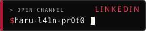
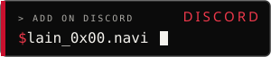
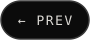
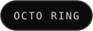
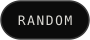

<a href="https://harshulkala.dpdns.org">
  <picture><source media="(max-width: 700px)" srcset="assets/m/hero.svg"></picture>
</a>

  
  
  

<picture><source media="(max-width: 700px)" srcset="assets/m/abyss.svg"></picture>

<picture><source media="(max-width: 700px)" srcset="assets/m/layer-01.svg"></picture>
<picture><source media="(max-width: 700px)" srcset="assets/m/about.svg"></picture>

<picture><source media="(max-width: 700px)" srcset="assets/m/layer-02.svg"></picture>
<!--PINNED:START-->
<a href="https://github.com/Wired-Navi0x17/Enigmaa"><picture><source media="(max-width: 700px)" srcset="assets/m/pinned/Enigmaa.svg"></picture></a>
<a href="https://github.com/Wired-Navi0x17/Wired-Navi0x17"><picture><source media="(max-width: 700px)" srcset="assets/m/pinned/Wired-Navi0x17.svg"></picture></a>
<a href="https://github.com/Wired-Navi0x17/Filevo"><picture><source media="(max-width: 700px)" srcset="assets/m/pinned/Filevo.svg"></picture></a>
<a href="https://github.com/Wired-Navi0x17/l41n-pr0t0_Portfolio"><picture><source media="(max-width: 700px)" srcset="assets/m/pinned/l41n-pr0t0_Portfolio.svg"></picture></a>
<!--PINNED:END-->

<picture><source media="(max-width: 700px)" srcset="assets/m/layer-03.svg"></picture>
<picture><source media="(max-width: 700px)" srcset="assets/m/toolkit.svg"></picture>

<picture><source media="(max-width: 700px)" srcset="assets/m/layer-04.svg"></picture>
<picture><source media="(max-width: 700px)" srcset="assets/m/system.svg"></picture>

<picture><source media="(max-width: 700px)" srcset="assets/m/layer-05.svg"></picture>
<picture><source media="(max-width: 700px)" srcset="assets/m/signal.svg"></picture>
<picture>
  <source media="(prefers-color-scheme: dark)" srcset="assets/snake-dark.svg">
  
</picture>

<picture><source media="(max-width: 700px)" srcset="assets/m/layer-06.svg"></picture>

  
  
  

  
  
  
  

<picture><source media="(max-width: 700px)" srcset="assets/m/footer.svg"></picture>
