<a href="https://harshulkala.dpdns.org">
  
</a>

  
  
  


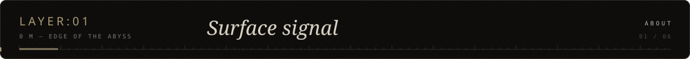
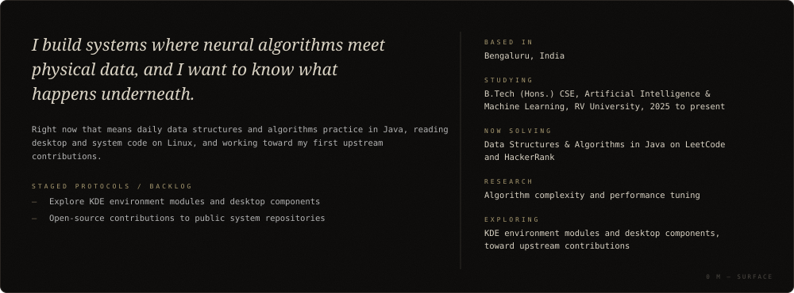

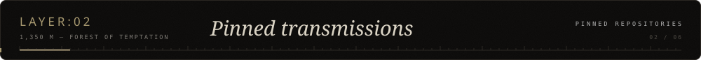
<!--PINNED:START-->
<a href="https://github.com/Wired-Navi0x17/Enigmaa">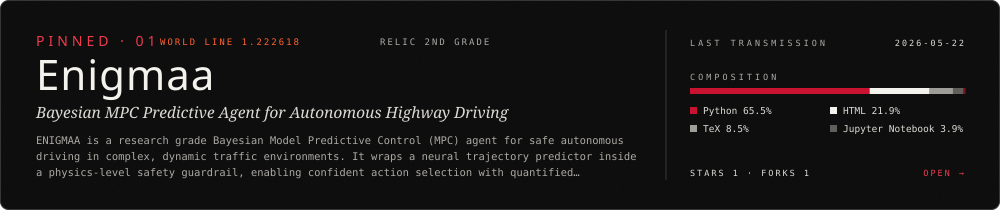</a>
<a href="https://github.com/Wired-Navi0x17/Wired-Navi0x17">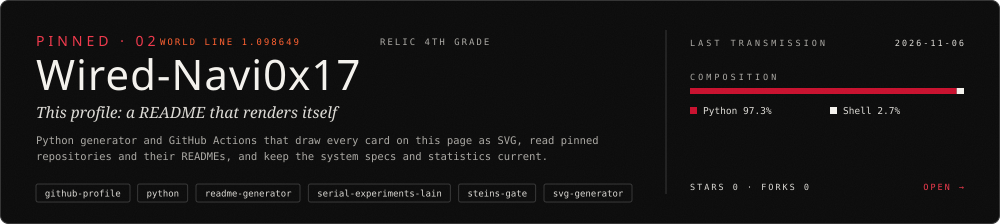</a>
<a href="https://github.com/Wired-Navi0x17/Filevo">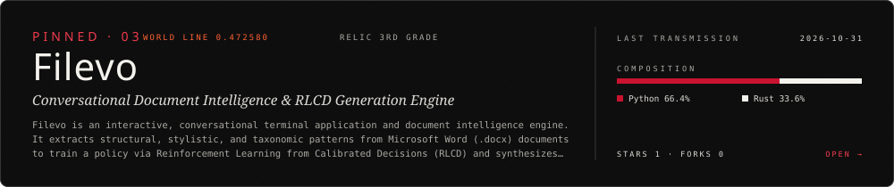</a>
<a href="https://github.com/Wired-Navi0x17/l41n-pr0t0_Portfolio">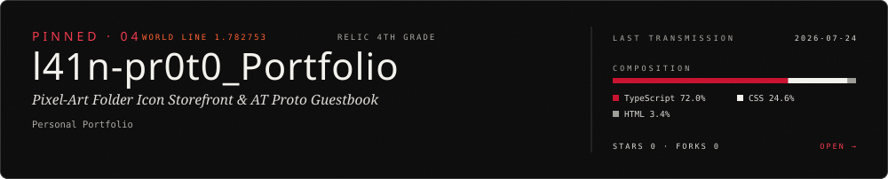</a>
<!--PINNED:END-->

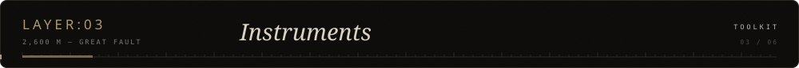
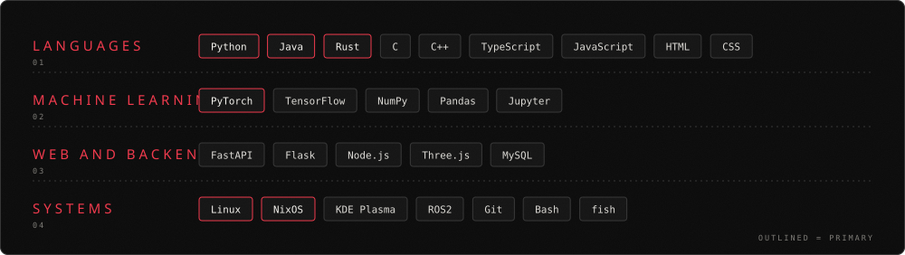

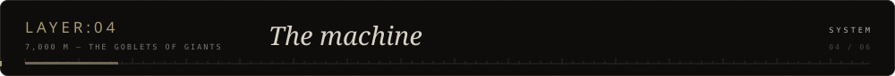
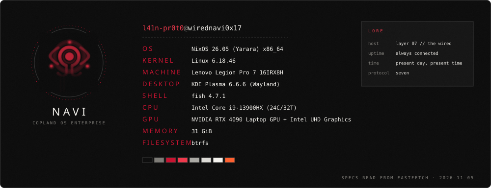

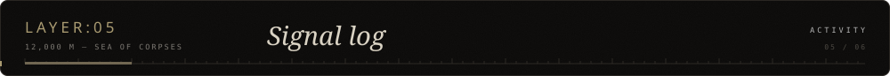
<picture>
  <source media="(prefers-color-scheme: dark)" srcset="assets/snake-dark.svg">
  
</picture>

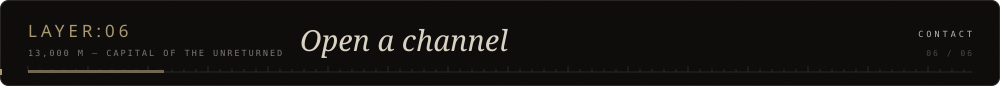

  <a href="https://harshulkala.dpdns.org">Website</a> &nbsp;/&nbsp;
  <a href="https://in.linkedin.com/in/haru-l41n-pr0t0">LinkedIn</a> &nbsp;/&nbsp;
  Discord <code>lain_0x00.navi</code>

  <a href="https://octo-ring.com/p/Wired-Navi0x17/prev">&larr; prev</a> &nbsp;
  <a href="https://octo-ring.com">Octo Ring</a> &nbsp;
  <a href="https://octo-ring.com/p/Wired-Navi0x17/random">random</a> &nbsp;
  <a href="https://octo-ring.com/p/Wired-Navi0x17/next">next &rarr;</a>

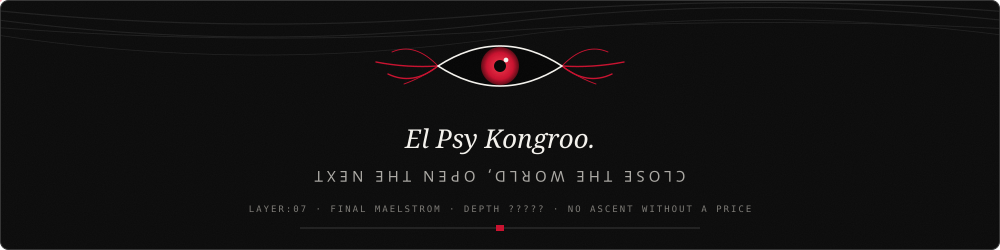
